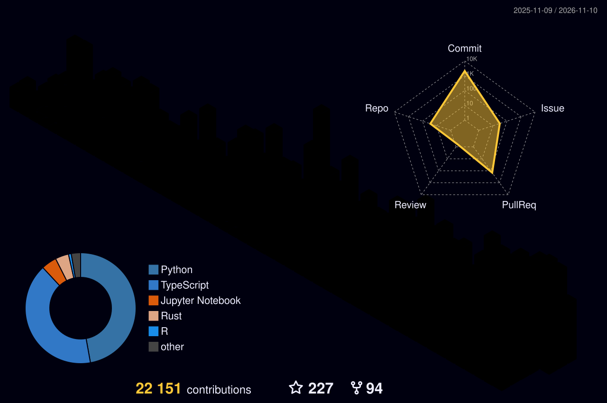

<!--     💙 Thanks for visiting!     -->
<!-- 🚀 Senior ML Engineer · PhD in Modeling · AI Educator 🚀 -->

---

## 👨‍💻 About Me

**🚀 13+ years turning research into production AI** — from Bayesian models & physics to RAG systems serving real-time traffic.

<table>
<tr>
<td width="50%">

### 🏢 Currently
**Senior ML Engineer @ Conversion Logix** — architecting production ML systems, real-time inference & GenAI pipelines with **13+ years** of experience turning research into deployed AI.

### 🎓 Background
**PhD in Modeling** & **MSc in Applied Physics** — deep work in time-series forecasting, Bayesian modeling & statistical inference.

</td>
<td width="50%">

### 🔭 Focus
RAG systems · transformer architectures · hybrid forecasting models · LLMOps

### 🧑‍🏫 Teaching
Professor & bootcamp lead — open courses on **Data Science, Data Engineering & Python Backend** used by hundreds of Spanish-speaking learners.

### 🌱 Learning
**Rust** & **Julia** for performance-critical and scientific computing

📍 Chile 🇨🇱 · Colombia 🇨🇴

</td>
</tr>
</table>

---

## 📊 GitHub Statistics

 

---

## 🚀 Featured Projects

<table>
<tr>
<td width="50%" align="center">

### 🧠 [AI-Evoolve](https://github.com/dfbustosus/AI-Evoolve)

*A curated showcase of the forefront of AI innovations & breakthroughs — LLMs, agents & generative systems.*

</td>
<td width="50%" align="center">

### 🏗️ [Curso-Data-Engineering](https://github.com/dfbustosus/Curso-Data-Engineering)

*Full open-source Data Engineering course (ES): pipelines, orchestration, streaming & warehouses.*

</td>
</tr>
<tr>
<td width="50%" align="center">

### 🎙️ [Verbi](https://github.com/dfbustosus/Verbi)

*Modular voice assistant — SOTA transcription, LLM response generation & TTS, with local models via Ollama.*

</td>
<td width="50%" align="center">

### 🤖 [NLP-and-Vision-Transformers](https://github.com/dfbustosus/NLP-and-Vision-Transformers)

*Latest NLP & Vision Transformer architectures applied to text and image tasks.*

</td>
</tr>
<tr>
<td width="50%" align="center">

### 🐍 [Curso-Python-Backend](https://github.com/dfbustosus/Curso-Python-Backend)

*Backend development course — Python + Django, from fundamentals to deployed web apps.*

</td>
<td width="50%" align="center">

### 📊 [Curso_DS_para_todos](https://github.com/dfbustosus/Curso_DS_para_todos)

*Data Science for everyone — a hands-on intro course with projects in Python.*

</td>
</tr>
<tr>
<td colspan="2" align="center">

### 🏁 [llmrace](https://github.com/dfbustosus/llmrace)

**New!** Race LLM providers head-to-head in your terminal — live TUI, TTFB, tokens/s, p95 latency & cost. OpenAI · Anthropic · Groq · OpenRouter · local Ollama · any OpenAI-compatible endpoint. Published on crates.io: `cargo install llmrace`. 🦀

</td>
</tr>
</table>

---

## 🧑‍🏫 Education & Open Teaching

I believe world-class AI education should be free and in your own language. Beyond my featured courses, I lead university bootcamps and publish the material openly:

- 🎓 **Bootcamps DS** — multi-cohort data science bootcamps ([2024-I](https://github.com/dfbustosus/Bootcamp-DS-2024-I) · [2023-I](https://github.com/dfbustosus/Bootcamp-DS-2023-I) · [2023-III](https://github.com/dfbustosus/Bootcamp-DS-2023-III))
- 📝 **[Curso-NLP-Python](https://github.com/dfbustosus/Curso-NLP-Python)** — NLP techniques for text processing
- ⚙️ **[C++ Course](https://github.com/dfbustosus/C_pp_course)** & **[Rust Course](https://github.com/dfbustosus/Rust_Course)** — systems programming foundations
- 🎥 **[YouTube](https://www.youtube.com/channel/UC4b2wnFR8zzoy8ApjUXaU-g)** — tutorials in Spanish on AI, ML & data

---

## 🔬 Research & Publications

PhD-level research at the intersection of **physics, statistics and machine learning** — time-series forecasting, Bayesian modeling, and validated ML applications (including medical-imaging studies).

---

## 🛠️ Tech Stack

**💻 Languages & Scientific Computing**  

**🤖 AI / Machine Learning**  

Core tooling 

**🎨 Frontend**  

**⚙️ Backend & APIs**  

**🗄️ Databases & Streaming**  

**☁️ DevOps · MLOps · Cloud**  

---

## 📈 Contribution Activity

*✨ 3D graph auto-generated by [github-profile-3d-contrib](https://github.com/yoshi389111/github-profile-3d-contrib)*

---

**"The goal is to turn data into information, and information into insight."** — Carly Fiorina

### 🤝 Open to collaborating on
`Open-source AI` · `Research projects` · `Speaking & workshops`

**Thanks for visiting! If my work helps you, consider leaving a ⭐ on any repo — it really helps!** 💙

